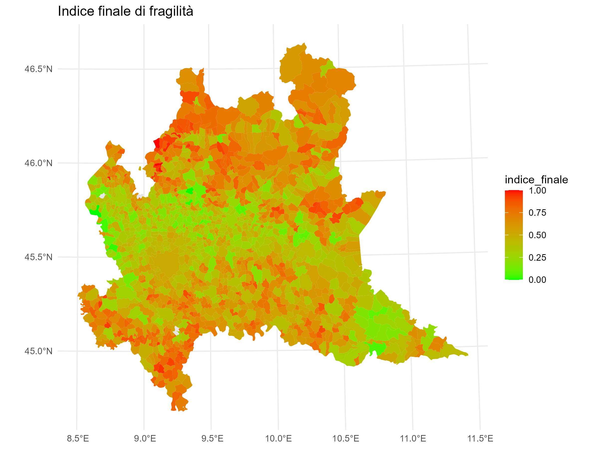

# Territorial Fragility Index

**Interpretable municipal indicators, spatial analysis and an interactive dashboard for Lombardy.**

Master's thesis by **Alessandro Ambrogi**, Politecnico di Milano. Advisor: **Francesca Ieva**; co-advisor: **Laura Savaré**.

The project studies territorial fragility in **2019 and 2021** across four dimensions: environment, sociodemographics, economy and services. It combines municipal data preparation, spatial methods and transparent composite indicators, with autoencoder comparisons and an R Shiny application.



## Approach

1. Harmonise municipal data and indicator direction so larger values represent greater fragility.
2. Construct macro-area indicators using rank transformations and distance-based aggregation.
3. Combine the four normalised macro-area scores by Euclidean distance from the ideal point, then rescale to [0, 1].
4. Explore spatial patterns, sensitivity, alternative latent representations and associations with health outcomes.

Year-specific normalisation produces relative scores: differences between the 2019 and 2021 maps must not automatically be read as absolute changes. A separate benchmark-year comparability analysis is preserved in `research/R/2021/`.

## Quick start: reproduce the final aggregation

```sh
python -m pip install -r requirements.txt
python scripts/rebuild_index.py
```

This lightweight workflow starts from the **saved, already normalised macro-area scores** for 1,506 municipalities per year. It regenerates the final index, checks municipality coverage and compares it against the saved thesis result. It does not reconstruct the upstream indicators from raw sources. Generated CSVs and verification JSON go to `results/generated/`.

## Explore the dashboard

```r
install.packages(c("shiny", "leaflet", "sf", "dplyr", "ggplot2", "janitor", "stringr", "tidyr"))
shiny::runApp("app")
```

The application includes its processed RDS data and municipal boundary files. It provides map-based exploration of indicators; the packaged app is independent of the much larger raw-data archive. The original online address is [fragilita-territoriale](https://aambrogi.shinyapps.io/fragilita-territoriale/); the local copy remains available if that service is offline.

## Explore the research

| Folder | Contents |
|---|---|
| `data/processed/` | Normalised components and reference final indices |
| `scripts/` | Portable final-aggregation workflow |
| `app/` | Original Shiny dashboard, processed data and boundaries |
| `research/R/` | Selected original methodology scripts, organised by year |
| `research/INDICI 2019/`, `research/INDICI 2021/` | Autoencoder notebooks and their macro-area input workbooks |
| `results/` | Original maps, method-comparison workbooks and selected interpretability figures |

## Data and reproducibility

See [DATA.md](DATA.md) for the scope and provenance of the included material, and [REPRODUCIBILITY.md](REPRODUCIBILITY.md) for the distinction between the runnable aggregation and the research archive. Notebook outputs and machine-specific deployment settings are excluded. Research notebooks require additional dependencies and are not executed by the quick start.

## Credits and use

This repository presents the author's thesis work and retains supervisor attribution. Municipal boundary fields and files retain their original source attribution and applicable terms. No new blanket license is assigned to third-party data or research material.
